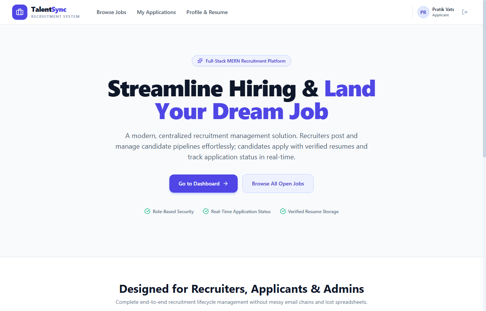
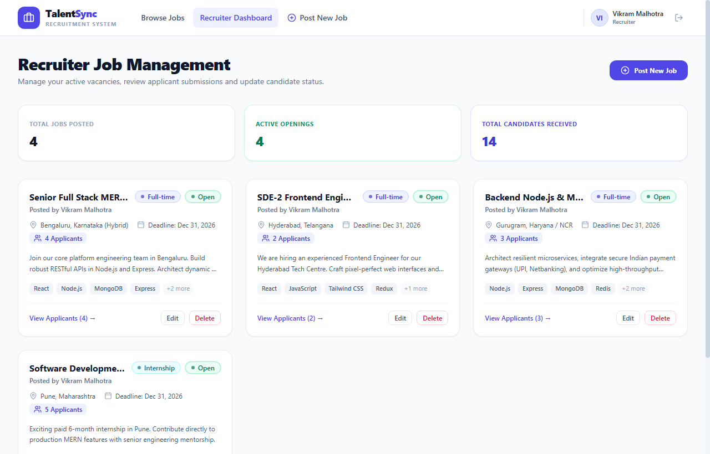
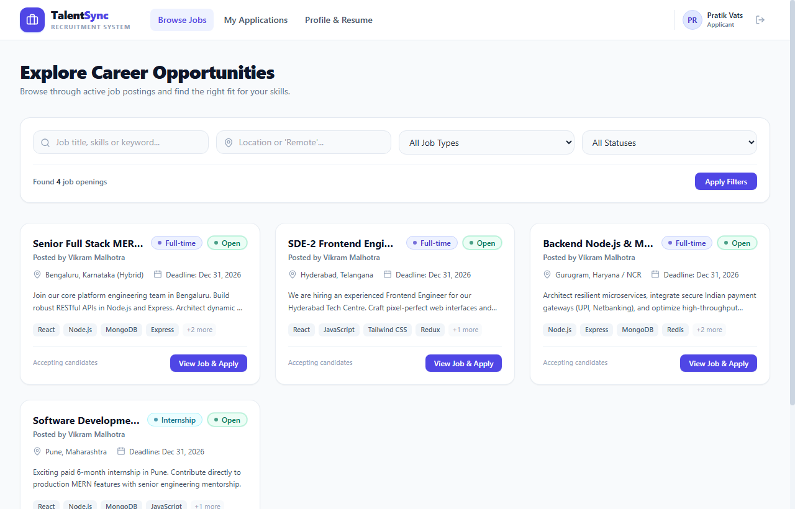
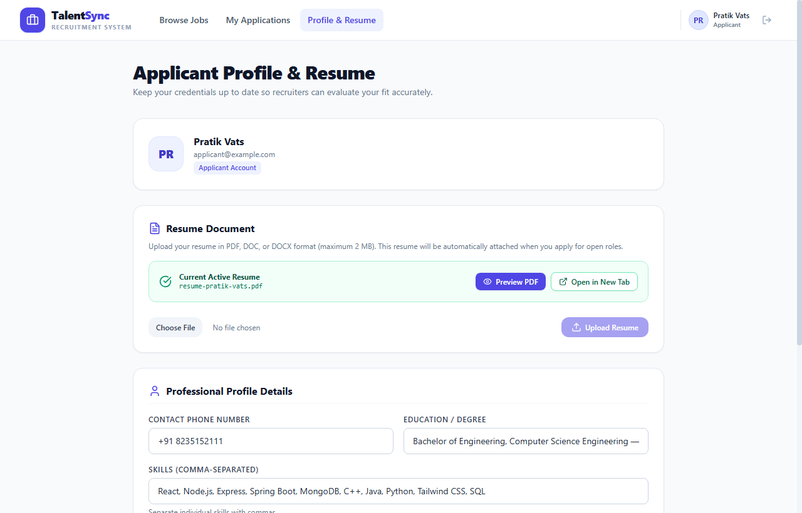
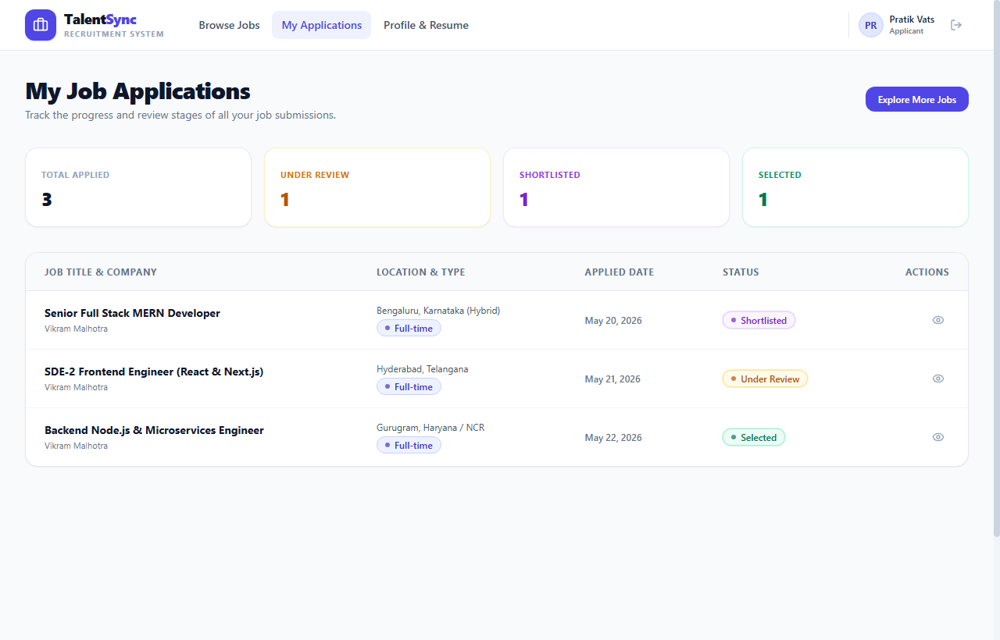
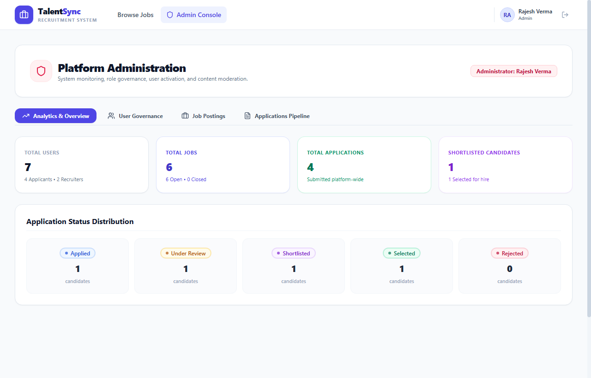
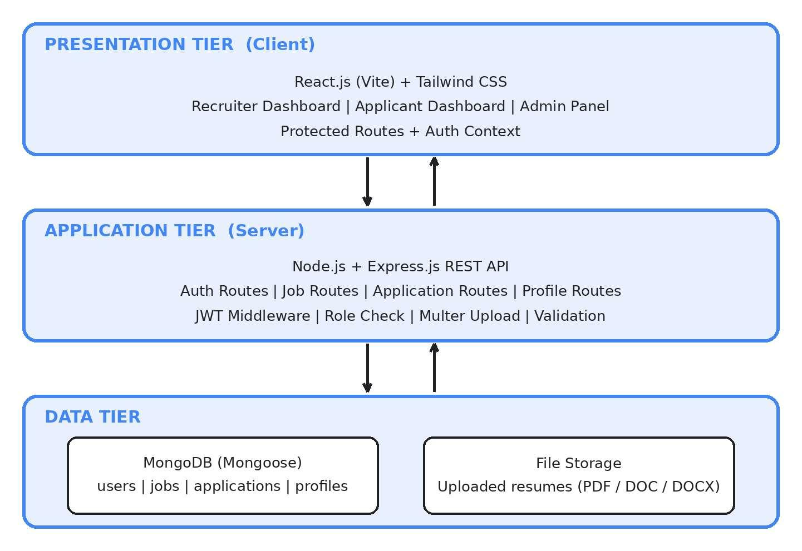
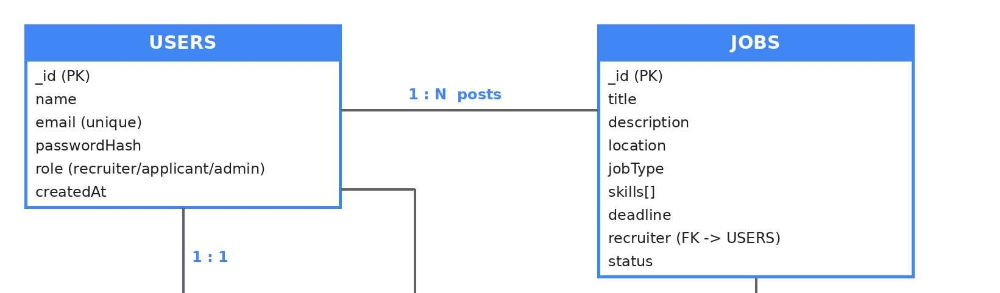
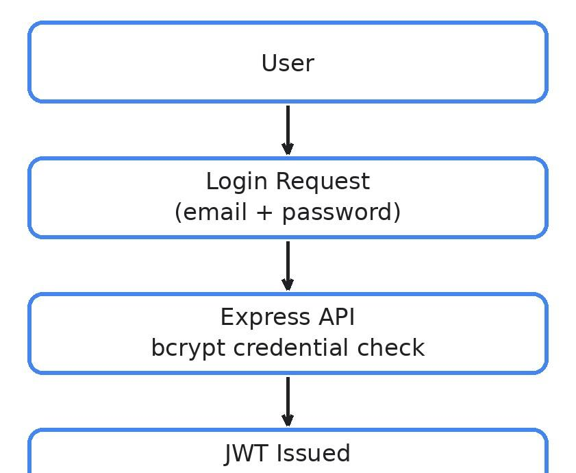
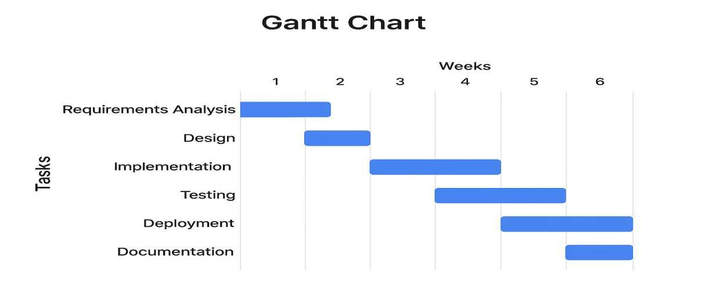

# TalentSync - Recruitment Management System (MERN Stack)


A production-ready full-stack Recruitment Management System (RMS) built on the MERN stack with a clean, modern **Light Theme**.

Derived from industrial training specifications, TalentSync provides end-to-end recruitment lifecycle operations: job creation and lifecycle management, candidate profile building, secure resume uploads (PDF/DOCX) with an in-app PDF preview viewer, application tracking with multi-stage status pipelines, and comprehensive administrative oversight.

---

## 📸 Real-Time Application Screenshots

### 1. 🌐 Landing Page & Role Portals
A welcoming, light-themed landing experience introducing platform capabilities, quick demo access, and streamlined registration.



---

### 2. 💼 Recruiter Job Management & Dashboard
Recruiters can create, edit, close, and monitor job listings in real-time with automatic applicant tracking and expiry checks.



---

### 3. 🔍 Job Discovery, Search & Filters
Applicants can explore open positions with live full-text keyword search across titles, descriptions, and required skills, combined with location, job type, and status filters.



---

### 4. 👤 Applicant Dashboard & Stage Progression
Candidates can monitor their submitted applications in real-time, view current review stages, inspect submitted cover letters, and withdraw applications.


---

### 5. 📄 Applicant Profile & Resume Document Management
Candidates maintain their credentials, degrees, and skills chips, and manage their uploaded resume with the integrated in-app **Preview PDF** viewer.



---

### 6. 🔐 Authentication & Single-Click Demo Access
Secure JWT login portal featuring one-click demo credentials for swift testing across Applicant, Recruiter, and Administrator personas.



---

### 7. 🛡️ Administrator Platform Governance & Analytics
Platform administrators gain birds-eye visibility into user accounts, active job openings, and pipeline distribution with instant activation toggling.



---

## 🏛️ System Architecture

TalentSync is built following a decoupled Three-Tier Model-View-Controller (MVC) architecture with strict separation of concerns, dual-layer Role-Based Access Control (RBAC), and streaming file authorization.



---

## 🗄️ Database Design (Entity-Relationship Diagram)

The MongoDB database utilizes four indexed collections linked via Mongoose references with compound unique constraints (such as enforcing one application per job per candidate).



---

## 🔄 End-to-End System Flowchart

The complete logical workflow covering authentication, job search, application submission, resume review, and recruiter stage progression:



---

## 📅 Project Development Timeline

Executed following an iterative Agile schedule covering requirements analysis, data modeling, API implementation, frontend UI engineering, hardening, and verification:



---

## 🛠️ Technology Stack

| Layer | Technology |
|---|---|
| **Frontend** | React 18, Vite, Tailwind CSS, React Router v7, Axios, Lucide Icons, Context API |
| **Backend** | Node.js, Express.js (REST API Architecture) |
| **Database** | MongoDB with Mongoose ODM |
| **Authentication** | JSON Web Tokens (JWT) & bcrypt.js password hashing |
| **File Storage** | Multer disk storage (randomized secure filenames and authorized streaming with in-app PDF preview) |
| **Security** | Helmet (CORP cross-origin), CORS, Express Rate Limit, NoSQL injection sanitization, input validation |

---

## 📂 Project Directory Structure

```text
Recruitment_Management_Project/
├── docs/
│   └── images/                   # Real-time screenshots & system architecture diagrams
├── server/
│   ├── config/
│   │   └── db.js                 # MongoDB connection logic
│   ├── controllers/
│   │   ├── authController.js     # User registration, login, session
│   │   ├── profileController.js  # Profile management, resume upload, secure file streaming
│   │   ├── jobController.js      # Job CRUD, search, filter, pagination
│   │   ├── applicationController.js # Apply, status pipeline, withdrawal
│   │   └── adminController.js    # Stats, user activation, governance
│   ├── middleware/
│   │   ├── auth.js               # JWT protection middleware (Header & query token fallback)
│   │   ├── role.js               # Role-based access control (RBAC)
│   │   ├── upload.js             # Multer resume configuration
│   │   ├── validate.js           # express-validator runner
│   │   └── errorHandler.js       # Centralized error handler
│   ├── models/
│   │   ├── User.js               # User collection schema
│   │   ├── Profile.js            # Profile collection schema
│   │   ├── Job.js                # Job postings collection schema
│   │   └── Application.js        # Applications collection schema
│   ├── routes/
│   │   ├── authRoutes.js
│   │   ├── profileRoutes.js
│   │   ├── jobRoutes.js
│   │   ├── applicationRoutes.js
│   │   └── adminRoutes.js
│   ├── uploads/resumes/          # Secure disk directory for resume files
│   ├── utils/
│   │   ├── generateToken.js      # JWT generator
│   │   └── seedAdmin.js          # Admin & sample demo database seeder
│   ├── .env                      # Environment configuration
│   ├── .env.example              # Example environment template
│   ├── app.js                    # Express app initialization
│   └── server.js                 # Server listener
├── client/
│   ├── src/
│   │   ├── api/axios.js          # Axios client with JWT interceptor & auto-logout
│   │   ├── context/
│   │   │   ├── AuthContext.jsx   # Global user state & persistence
│   │   │   └── ToastContext.jsx  # Toast notification provider
│   │   ├── components/
│   │   │   ├── Navbar.jsx        # Responsive navigation with role links
│   │   │   ├── Footer.jsx        # Light-themed footer
│   │   │   ├── JobCard.jsx       # Job card component
│   │   │   ├── StatusBadge.jsx   # Stage and status indicators
│   │   │   ├── FormInput.jsx     # Reusable form controls
│   │   │   ├── Modal.jsx         # Accessible modal dialog
│   │   │   ├── ResumePreviewModal.jsx # In-app PDF and document viewer
│   │   │   ├── Spinner.jsx       # Loading indicator
│   │   │   ├── EmptyState.jsx    # Zero-data feedback
│   │   │   └── Pagination.jsx    # Clean page navigation
│   │   ├── pages/
│   │   │   ├── public/           # Landing, Login, Register, JobList, JobDetail, 404
│   │   │   ├── applicant/        # ApplicantDashboard, ApplicantProfile
│   │   │   ├── recruiter/        # RecruiterDashboard, JobForm, JobApplications
│   │   │   └── admin/            # AdminDashboard
│   │   ├── routes/
│   │   │   └── ProtectedRoute.jsx# Role-gated route enforcement
│   │   ├── utils/
│   │   │   └── fileUrl.js        # Authenticated resume URL generator
│   │   ├── App.jsx               # Route mappings
│   │   └── main.jsx
│   ├── tailwind.config.js
│   └── vite.config.js
├── Recruitment_Management_System_API.postman_collection.json # Full Postman suite
└── README.md
```

---

## ⚡ Getting Started

### 1. Prerequisites
- **Node.js**: v18+ or v20 LTS or v24
- **MongoDB**: Local MongoDB instance (`mongodb://127.0.0.1:27017`) or MongoDB Atlas URI

---

### 2. Backend Setup
1. Open a terminal and navigate to `server`:
   ```bash
   cd server
   ```
2. Install dependencies:
   ```bash
   npm install
   ```
3. Verify or adjust `server/.env`:
   ```env
   PORT=5000
   MONGO_URI=mongodb://127.0.0.1:27017/recruitment_management_db
   JWT_SECRET=super_secret_jwt_key_recruitment_system_2026_production_ready
   JWT_EXPIRES_IN=1d
   CLIENT_URL=http://localhost:5173
   ADMIN_EMAIL=admin@example.com
   ADMIN_PASSWORD=Admin@123456
   NODE_ENV=development
   ```
4. Seed the database with the administrator, demo recruiters, and sample applicants:
   ```bash
   npm run seed
   ```
5. Start the backend development server:
   ```bash
   npm run dev
   ```
   *The backend will start at `http://localhost:5000`.*

---

### 3. Frontend Setup
1. Open a second terminal and navigate to `client`:
   ```bash
   cd client
   ```
2. Install dependencies:
   ```bash
   npm install
   ```
3. Start the Vite development server:
   ```bash
   npm run dev
   ```
   *The client will launch at `http://localhost:5173`.*

---

## 🔑 Demo Login Accounts

| Role | Name | Email | Password | Scope & Dashboard Access |
|---|---|---|---|---|
| **Job Applicant** | Pratik Vats | `applicant@example.com` | `Applicant@123` | Build profile, upload resume, search jobs, apply, withdraw |
| **Recruiter** | Vikram Malhotra | `recruiter@example.com` | `Recruiter@123` | Post/edit/delete own jobs, review applicants, change status |
| **Platform Administrator** | Rajesh Verma | `admin@example.com` | `Admin@123456` | Full system overview, user activation toggle, delete user/jobs |

> *Tip: On the `/login` screen, quick-fill buttons are provided to instantly populate demo credentials with a single click.*

---

## 📡 API Reference Overview

Base URL: `/api`

### Auth (`/api/auth`)
- `POST /register` – Register applicant or recruiter
- `POST /login` – Authenticate user and return signed JWT
- `GET /me` – Fetch current user profile

### Profile (`/api/profile`)
- `GET /me` – Get applicant profile (Applicant)
- `PUT /me` – Update applicant profile (Applicant)
- `POST /resume` – Upload resume file (PDF/DOC/DOCX up to 2 MB) (Applicant)
- `GET /:userId` – View candidate profile (Recruiter/Admin)
- `GET /resume-file/:filename` – Secure resume file streaming & in-app viewer (Owning Applicant, Relevant Recruiter, Admin)

### Jobs (`/api/jobs`)
- `GET /` – Search & filter jobs with pagination (`?q=&location=&jobType=&status=&page=&limit=`)
- `GET /mine` – Recruiter's jobs with applicant counts (Recruiter)
- `GET /:id` – Single job details
- `POST /` – Create new job opening (Recruiter)
- `PUT /:id` – Update job opening (Recruiter owner)
- `DELETE /:id` – Delete job opening (Recruiter owner, Admin)

### Applications (`/api/applications`)
- `POST /:jobId` – Apply to a job with resume and cover letter (Applicant)
- `GET /mine` – View own submitted applications (Applicant)
- `DELETE /:id` – Withdraw application (only while `Applied`) (Applicant)
- `GET /job/:jobId` – View all applications for a job (Recruiter owner)
- `PATCH /:id/status` – Update candidate status stage (Recruiter owner)

### Admin (`/api/admin`)
- `GET /stats` – Platform metrics & application status counts (Admin)
- `GET /users` – List all users with role filtering & search (Admin)
- `PATCH /users/:id/active` – Activate or deactivate user (Admin)
- `DELETE /users/:id` – Delete user and cascade associated records (Admin)
- `GET /jobs` – List all platform jobs (Admin)
- `GET /applications` – List all platform applications (Admin)

---

## 📬 Postman Collection
Import the file:
`Recruitment_Management_System_API.postman_collection.json`
directly into Postman. It contains pre-configured requests, environment variables (`baseUrl`, `adminToken`, `recruiterToken`, `applicantToken`, `jobId`, `applicationId`), and sample JSON payloads.

---

## 🔒 Security Best Practices Implemented
1. **Password Hashing:** Passwords hashed with `bcryptjs` (10 rounds); password hashes excluded by default (`select: false`).
2. **Access Control:** Dual-layer RBAC on both server API routes and client React routes.
3. **Resume Protection & Streaming:** Resumes stored on disk and served strictly via authorized endpoint checks with inline PDF headers (`Content-Disposition: inline`).
4. **Injection Protection:** NoSQL query sanitizer strips `$` and `.` operators from request payloads.
5. **Rate Limiting:** Protects auth endpoints against brute-force attacks.

---

## 🚀 Production Deployment Guide

TalentSync is fully configured for zero-friction cloud deployment either as an **All-in-One Service** (recommended) or as **Split Services**.

### Option A: All-in-One Deployment (Render, Railway, Heroku)

Deploy the entire full-stack app (React frontend + Express backend) as a single Web Service:

1. **Connect Repository:** Link this GitHub repository on [Render](https://render.com) or [Railway](https://railway.app).
2. **Configure Service:**
   - **Environment:** `Node`
   - **Build Command:** `npm run build`
   - **Start Command:** `npm start`
3. **Set Environment Variables:**
   - `NODE_ENV`: `production`
   - `PORT`: `10000` (or platform default)
   - `MONGO_URI`: `mongodb+srv://<username>:<password>@cluster0.xxxxx.mongodb.net/recruitment_management?retryWrites=true&w=majority`
   - `JWT_SECRET`: `<your-random-production-jwt-secret>`
   - `JWT_EXPIRES_IN`: `1d`
   - `ADMIN_EMAIL`: `admin@example.com`
   - `ADMIN_PASSWORD`: `<your-secure-admin-password>`
4. **Deploy:** The server automatically compiles the client, serves production static files from `client/dist`, connects to MongoDB Atlas, and auto-seeds initial accounts on first startup!

### Option B: Split Deployment (Vercel Frontend + Render Backend)

- **Backend (Render / Railway):**
  - **Root Directory:** `server`
  - **Build Command:** `npm install`
  - **Start Command:** `node server.js`
  - **Env Var:** Set `CLIENT_URL=https://<your-app>.vercel.app`
- **Frontend (Vercel / Netlify):**
  - **Root Directory:** `client`
  - **Build Command:** `npm run build`
  - **Output Directory:** `dist`
  - **Env Var:** Set `VITE_API_URL=https://<your-backend-service>.onrender.com/api`

